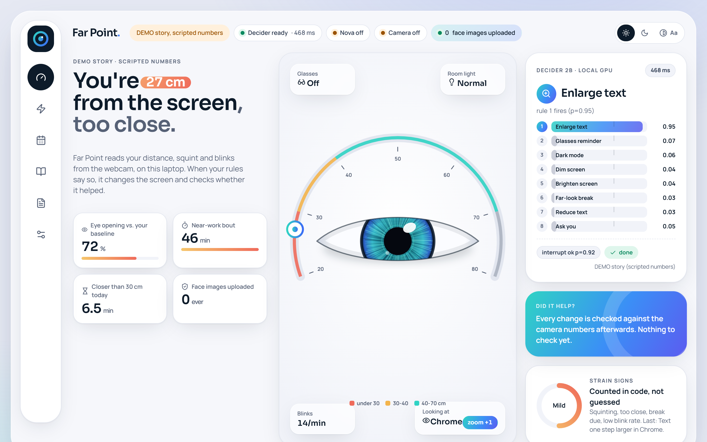
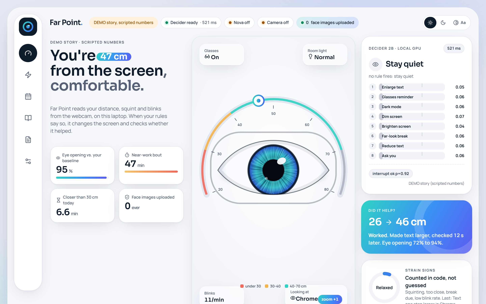
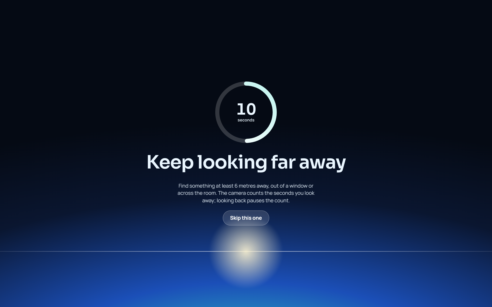
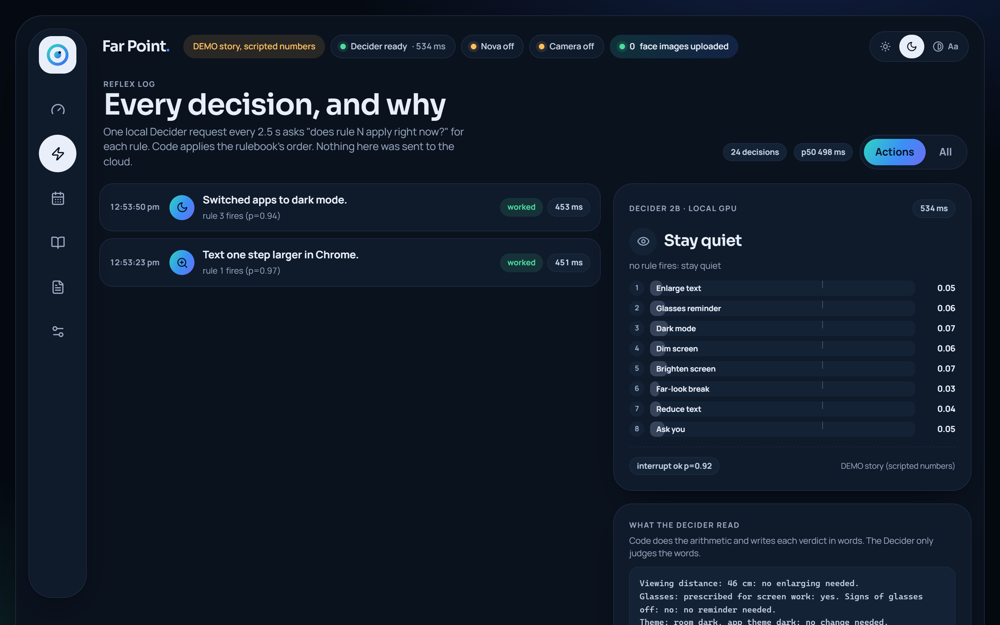
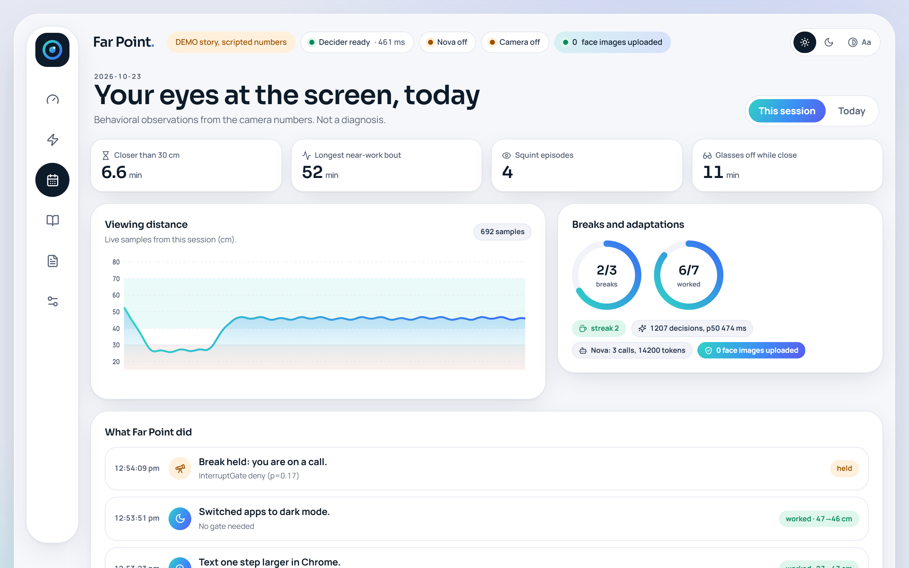
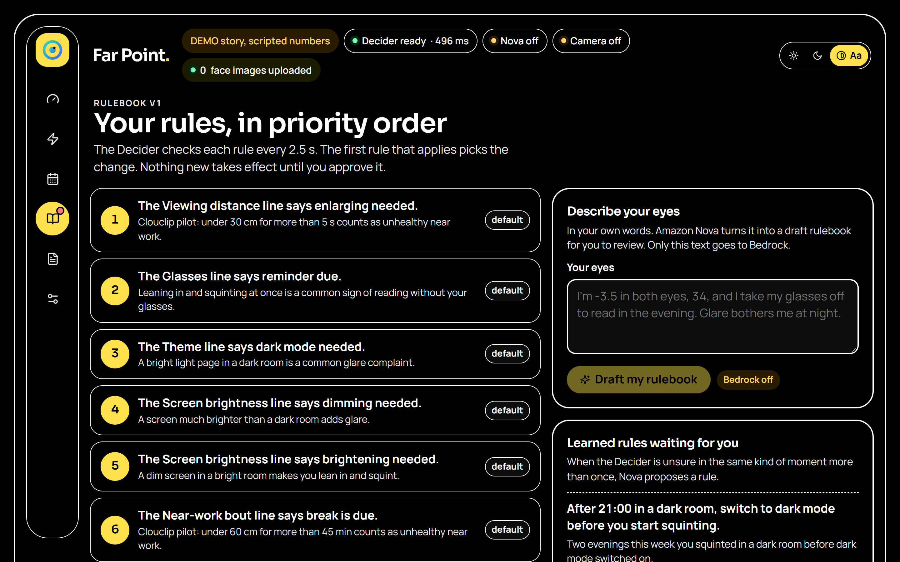

# Far Point



Far Point watches how you use your eyes at the screen and adapts the screen to you. The webcam measures viewing distance, squint, blinks and head turns on the laptop. Every 2.5 seconds a local Strands Decider 2B checks your personal rulebook against those numbers. Then a Strands Agent changes something reversible, such as text zoom, dark mode, brightness or a camera-verified 20-second far-look break, and checks whether it helped. Amazon Nova on Bedrock writes your rulebook from your own description of your eyes, writes numbers-only reports, proposes new rules for you to approve and drafts an eye-exam email it never sends. Bedrock only ever gets words and numbers, never an image.

Not a medical device. Far Point does not diagnose, treat or prevent any eye condition. Its reports are behavioral observations, not a diagnosis.

## The decision handed to the Decider

Declared pattern: `#tool-selection` with `#strands-decider-2b`. The reusable version is in [`patterns/reflex_gate/`](patterns/reflex_gate/README.md).

1. Code turns the measurements into words and does all the arithmetic. Each line ends with a verdict, for example `Viewing distance: 27 cm, under 30 cm for 8 s (limit 5 s): too close, enlarging needed.`
2. One local Decider request asks one `noul` per rule ("does rule N apply right now?") plus `interrupt_ok`. That is 9 questions in about 0.45-0.57 s on this RTX 4060 laptop.
3. Code applies the rulebook's priority order and a confidence policy. A rule fires at p >= 0.65, is clear at p <= 0.35, and is unsure in between. When a higher-priority rule is unsure, Far Point asks Amazon Nova Lite about it with the same text. If that is not possible, it stays quiet ("fail quiet").
4. The chosen tool runs through a Strands Agent (`agent.tool.<name>()`). Strands interventions gate it: `InterruptGate` denies breaks and reminders during calls, typing or fullscreen video, and `ConfirmGate` puts your approval in front of adopting a rulebook or opening the email draft.

## Architecture

| Stage | What happens | Where |
|---|---|---|
| MEASURE | MediaPipe FaceLandmarker: iris-based distance, eye opening vs your baseline, blinks, head angles, frame brightness. Foreground app via Win32 | Local. Frames stay in memory and are dropped |
| DECIDE | Strands Decider 2B (`StrandsAgents/strands-decider-2B-qwen3.5-v1-2610`), text-only, one request per tick, behind one process-wide lock | Local GPU, 127.0.0.1:8099 |
| ACT | Strands Agent tools: `enlarge_text`, `reduce_text`, `dark_mode`, `dim_screen`, `brighten_screen`, `far_look_break`, `glasses_reminder`, `ask_user`, `reset` | Local |
| VERIFY | 30 s after a change, the camera numbers decide `worked` / `no_change` / `worse` / `n/a`. A break is verified by looking away for 20 s. Adaptations that rarely work in an app get demoted there | Local |
| COACH | Amazon Nova Lite through a Strands Agent: rulebook authoring, reports, rule proposals, exam email draft | Bedrock, us-east-1, text and numbers only |

The dashboard shows `face images uploaded: 0`. Nothing increments that counter (`farpoint/privacy.py`).

Text-only mode: the Decider runs without images (`eval/SPIKE_RESULTS.md`, mode decision). Glasses off and leaning in are inferred from distance and squint changes. They are not seen.

## Default thresholds

The near-work limits come from the Clouclip pilot: closer than 30 cm for more than 5 s, or closer than 60 cm for more than 45 min, counts as unhealthy near work. Cao Y, Lan W, Wen L, et al. "An effectiveness study of a wearable device (Clouclip) intervention in unhealthy visual behaviors among school-age children: A pilot study." *Medicine (Baltimore)* 2020;99(2):e17992. PMID [31914011](https://pubmed.ncbi.nlm.nih.gov/31914011/). The cohort was school-age children; Far Point applies the thresholds to adults as a starting point, and your rulebook can change them within clamped ranges. The 40 cm "worked" bar and the squint gain used in verification are engineering choices, not clinical thresholds.

## Measured

| What | Result | Source |
|---|---|---|
| One 9-way `choice` vs the rulebook (Phase 1, held-out) | 68.1% | [`eval/SPIKE_RESULTS.md`](eval/SPIKE_RESULTS.md) |
| Per-rule nouls + code priority (S3, held-out seed 4, preregistered) | **87.5%** end to end, 100% with Nova Lite on the 9 states that had an unsure rule | [`eval/S3_RESULTS.md`](eval/S3_RESULTS.md) |
| Same decomposition on Phase 1's text (ablation) | 30.6%: the renderer does most of the work | [`eval/S3_RESULTS.md`](eval/S3_RESULTS.md) |
| Latency, 8 rule nouls + `interrupt_ok` | p50 458-574 ms, p90 533-612 ms | `results/s3_*.json` |
| Image mode (Phase 1) | Fits in VRAM (peak 6.56 GB), 0.51 s p50. Accuracy not measured, so it stays off | [`eval/SPIKE_RESULTS.md`](eval/SPIKE_RESULTS.md) |

The states are synthetic. The weaknesses are written up in both results files.

## Run it (Windows, PowerShell)

Setup: `uv venv --python 3.12 .venv`, then `uv pip install -r requirements.txt`. Install torch first from the cu128 index. Keep the caches off C:, for example `$env:HF_HOME="E:\farpoint-runtime\hf"`. Runtime data (profile, rulebook, stats, recordings, restore journal) goes to `FARPOINT_RUNTIME`, which defaults to `E:\farpoint-runtime`, never into the repo.

```powershell
.\scripts\start_decider.ps1                         # local Decider on 127.0.0.1:8099 (text mode, High priority)
.venv\Scripts\python.exe scripts\calibrate.py --distance-cm 50   # once, sitting at a measured 50 cm

# Live: camera + Decider + Bedrock (if AWS credentials exist). Dashboard on http://127.0.0.1:8765/
.venv\Scripts\python.exe -m farpoint.app --mode live
.venv\Scripts\python.exe -m farpoint.app --mode live --dry-run     # same, but never touch zoom/brightness/theme

# Replay: the synthetic 4-minute demo session (no camera, no GPU, no AWS; dry-run actuators)
.venv\Scripts\python.exe -m farpoint.app --mode replay --trace farpoint\replay\demo_session.jsonl --fake-decider --no-bedrock
.venv\Scripts\python.exe scripts\replay_story.py --real-decider    # the same trace through the real Decider, printed

# Tests (no GPU, no AWS, no camera). Live tests: $env:FARPOINT_LIVE=1
.venv\Scripts\python.exe -m pytest -q
.venv\Scripts\python.exe scripts\e2e_ui_check.py                    # the backend as the UI sees it
.venv\Scripts\python.exe scripts\smoke_live.py                      # real Decider, Nova, camera, one real adaptation
```

`--fake-decider` replaces the Decider with an oracle over the reference predicates. The dashboard then shows the model as `FAKE oracle (tests/demo)`.

## Dashboard

The backend serves the dashboard from `web/dist` at http://127.0.0.1:8765/. It speaks one WebSocket contract ([`docs/ui-contract.md`](docs/ui-contract.md), plus the optional fields in [`docs/backend-extensions.md`](docs/backend-extensions.md)).

| Screen | What it shows |
|---|---|
| Now | A drawn eye (not a camera image): the lid follows your measured eye opening, the pupil follows room light, and the dial is your viewing distance. Next to it: the Decider's latest answer per rule, the gate verdict, and "Did it help?" (before and after distance) |
| Reflex log | Every decision with its latency, the rule that fired or why it stayed quiet, and the exact text the Decider read |
| Day | Minutes closer than 30 cm, longest bout, breaks verified, adaptations that worked, and the distance curve |
| Rulebook | Your rules in priority order, "describe your eyes" (Nova drafts a rulebook you adopt), and learned rules to approve or reject |
| Report | Nova's numbers-only report for your optometrist and the exam-email draft, which opens only after you confirm |
| Setup | Distance calibration, camera pause, system status, the not-a-medical-device note |

Themes: Day, Night, and a high-contrast large-text mode. `?demo=1` plays a scripted demo story in the browser with no backend (it is labelled DEMO on screen). The front end is Vite + React + TypeScript with no UI framework; build it with `cd web; npm ci; npm run build`.

| | |
|---|---|
|  |  |
|  |  |
|  |  |

The screenshots come from the in-browser demo story (`scripts/ui_screenshots.py`), so their numbers are scripted, not measured.

## Reversibility

Every change is undone on exit:

- Text zoom: inverse key steps per window (Ctrl+= / Ctrl+-, Ctrl+wheel in Word), sent only to allowlisted apps and only when you are not typing or holding a modifier. Not Ctrl+0, because your own zoom level is unknown.
- App theme: `AppsUseLightTheme` back to its original value.
- Brightness: back to the original level (internal panel only, via WMI).

Each original is written to `<runtime>/restore.json` before the change. On exit, from Ctrl+C or atexit, `restore_all()` puts everything back. If the app crashes, the next start restores what the journal holds. The `reset` tool undoes everything immediately.

## Security and privacy

- The server binds to 127.0.0.1 only and refuses any other host, including the Host header. The WebSocket has no authentication, so it accepts only localhost Origins, which blocks other browser tabs from hijacking it.
- The Decider server binds to 127.0.0.1 only. `DeciderHttpClient` refuses to send images to any host that is not localhost.
- Camera frames, screenshots and face images are never written to disk or sent anywhere. Replay traces and recordings hold numbers only.
- Bedrock receives the rendered text state and daily numbers. Token use is logged to `<runtime>/profile/bedrock-usage.jsonl`.

## Layout

| Path | Purpose |
|---|---|
| `farpoint/` | The agent: `sense`, `signals`, `context`, `facts`, `doctrine`, `loop`, `tools`, `agent`, `act`, `breaks`, `verify`, `memory`, `escalate`, `coach`, `bus`, `dashboard`, `runtime`, `app` |
| `web/` | Dashboard (Vite + React + TypeScript); `web/dist` is committed so the backend can serve it without Node |
| `patterns/reflex_gate/` | Reusable decision pattern (per-rule nouls, policy, InterruptGate / ConfirmGate, fakes, posture example) |
| `eval/`, `results/` | Preregistrations, spikes S1-S3 and their raw results |
| `scripts/` | Decider start, calibration, demo trace, smoke tests, pre-push scan |
| `tests/` | pytest suite |

## License

Apache-2.0. See `LICENSE` and `NOTICE`.
