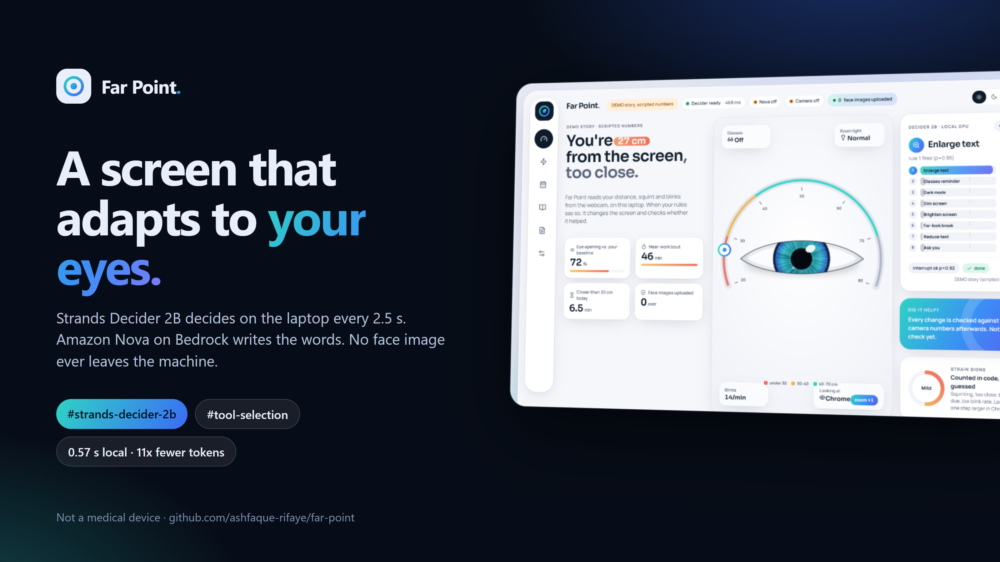
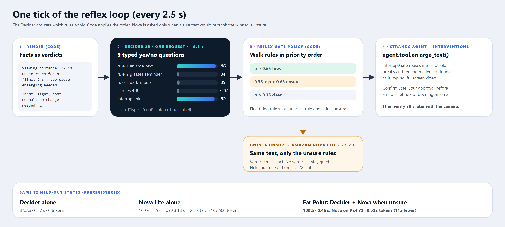
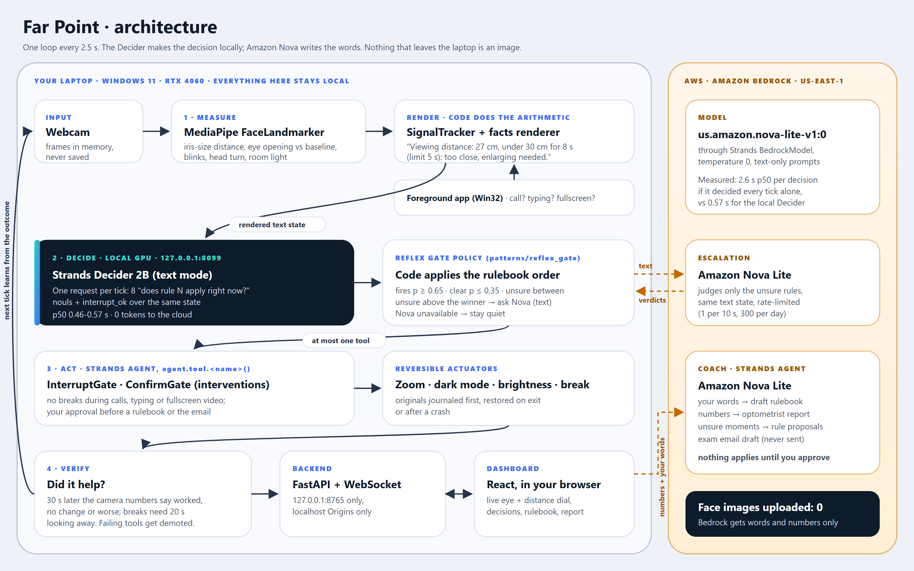
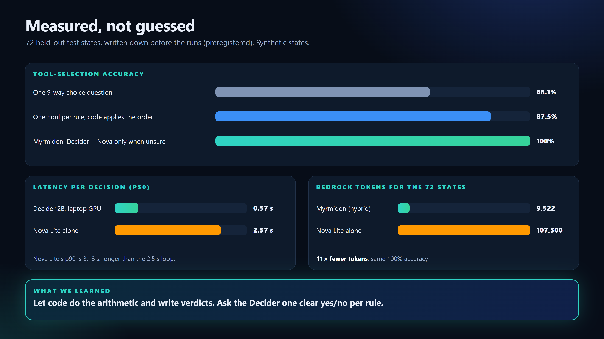
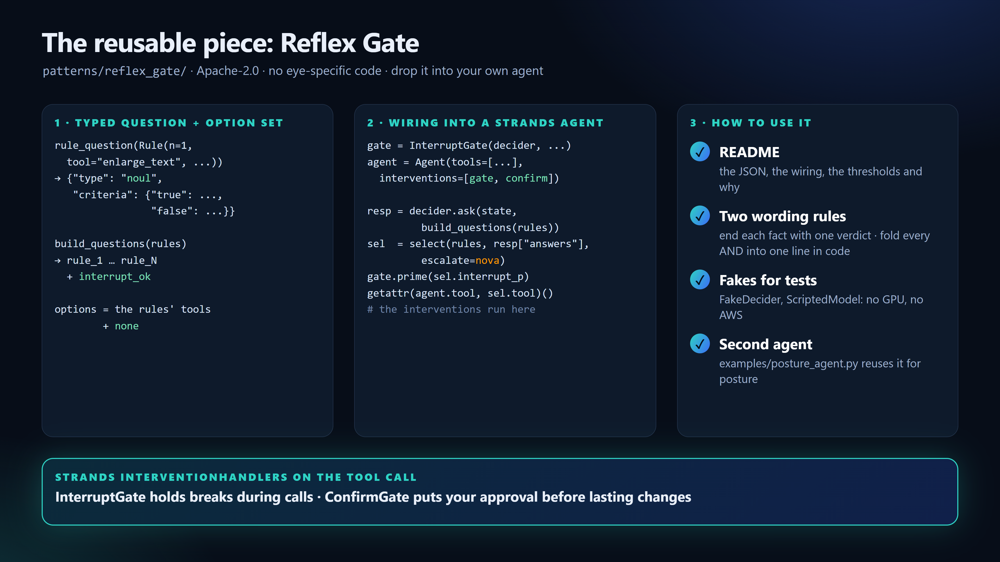

# Myrmidon: a screen that adapts to your eyes, decided locally by Strands Decider 2B

Tags: `#strands-decider-2b` `#tool-selection`

Repo: https://github.com/ashfaque-rifaye/myrmidon (Apache-2.0) · Live demo: https://main.d15fdmq2raifi0.amplifyapp.com/ · Video: <add YouTube link>

> Not a medical device. Myrmidon does not diagnose, treat or prevent any eye condition.

**In one paragraph.** Myrmidon is a Windows laptop agent that watches how you use your eyes at the screen and changes the screen to help: bigger text when you lean in, dark mode in a dark room, a far-look break that only counts when the camera sees you look away. Every 2.5 seconds, **Strands Decider 2B, running on the laptop GPU, makes the tool-selection decision**: which of the rulebook's tools, if any, should run right now. A Strands Agent runs that tool behind two Strands intervention handlers, and the camera checks 30 seconds later whether it helped. **Amazon Bedrock (Nova Lite)** does the language: it turns your own words into the rulebook the Decider reads, gives a second opinion only when the Decider is unsure, and writes a numbers-only report. No face image ever leaves the laptop.

| The hackathon asks for | Where it is |
|---|---|
| An agent that uses Decider 2B for a meaningful decision, paired with Amazon Bedrock | Tool selection every 2.5 s on the laptop; Nova Lite on Bedrock for the rulebook, unsure rules and reports |
| The decision pattern | **#tool-selection**: which tool, if any, from what the user is doing, read against the rules they wrote |
| A reusable Decider 2B pattern | **Reflex Gate**, `patterns/reflex_gate/`: typed question and option set, the InterventionHandler wiring, a README, and a second agent (posture) built on it |
| A measured latency or cost improvement (bonus) | Same 100% accuracy as Nova Lite alone, at a p50 of 0.46 s instead of 2.57 s per decision, with 11x fewer Bedrock tokens |

*Dashboard screenshots come from its built-in demo story, so their numbers are scripted. The video shows a recorded session replayed through the real Decider and Nova. The results tables are measured.*

## The moment it is built for

It is late. My glasses are on the desk, the page is small, and I have crept to 26 cm from the screen without noticing. Nearsightedness is common and growing; a widely cited projection puts it at about half the world's population by 2050 (Holden et al., *Ophthalmology*, 2016). In children, reading closer than 30 cm and long unbroken stretches of near work are linked to higher myopia risk.

Apple's Screen Distance and wearables like Clouclip warn you when you are too close. Myrmidon tries something else: it changes the screen so that sitting back is possible, and then it checks with the camera whether you actually sat back.

## How it reads your eyes

All of this runs on the laptop, from a plain webcam, and every frame is dropped after it is measured.

- **Distance.** MediaPipe's Face Landmarker finds 478 face points per frame, including the edges of each iris. An iris is about 11.7 mm wide in almost everyone, so `distance = focal length × 11.7 mm ÷ iris width in pixels`.
- **Your baseline.** A one-time calibration at a distance you measured sets the camera's focal length and how open your eyes normally are. Everything after that is compared to you, not to an average person. Distance is accurate to roughly 10% after calibration.
- **Squint and blinks.** Eye opening divided by your baseline: under 75% for a while is squinting; a short dip under 60% is a blink. Head turn tells whether you are looking away during a break.
- **Context.** The foreground app, typing bursts, fullscreen video and calls come from Win32.

Code then writes each number as a sentence that ends in a verdict, for example `Viewing distance: 27 cm, under 30 cm for 8 s (limit 5 s): too close, enlarging needed.` That text is what the Decider reads.

**What you get out of it.** The screen adapts in the app you are in (text one step larger or smaller, dark mode, brightness) and every change is undone on exit. Breaks arrive at a good moment and only count when you really look away. Each change is checked 30 seconds later against your own numbers ("27 → 45 cm, worked"), and a change that keeps failing in an app is demoted there. At the end of the day Nova writes a report of minutes too close, longest near-work bout, breaks taken and squint episodes, which you can take to an eye exam.

## The decision handed to Decider 2B

Declared pattern: **tool selection**. Which tool, if any, should run right now? The user's input is not a typed request: it is what they are doing (how close they sit, how open their eyes are, which app is in front) read against the rulebook they wrote in their own words.

Why this decision suits Decider 2B: it is made **over and over**, every 2.5 seconds, about 11,500 times in an 8-hour day, so it has to be fast, local and free per call. It needs a **calibrated confidence**, because a wrong interruption is worse than a missed one. And it is a **typed judgement over text**, which is what the Decider does, not text generation.

How it is used:

- **One typed `noul` per rule.** "Does rule N apply right now?" with explicit `true` and `false` criteria. All eight rules plus `interrupt_ok` go in **one request** over the same state: 9 answers in about 0.5 s on the laptop's RTX 4060, with no cloud tokens.
- **Code applies the order and a confidence policy.** A rule fires at p ≥ 0.65 and is clear at p ≤ 0.35. If a higher-priority rule lands in between, Myrmidon asks Nova Lite on Bedrock about just those rules, with the same text. If Nova is unavailable, it stays quiet.
- **Strands intervention handlers sit on the tool call.** `InterruptGate` denies breaks and reminders during a call, a typing burst or fullscreen video, reusing the batched `interrupt_ok` answer (p 0.18 on a Teams call in the video). `ConfirmGate` puts your approval in front of adopting a rulebook or opening the exam email.

My first design asked one 9-way `choice` question. On a preregistered held-out set it agreed with the rulebook on **68.1%** of states: it read the state fine but applied the priority order badly. Splitting the decision into one yes/no per rule, with code applying the order, is what made it work.

## Architecture

Solid arrows run on the laptop every tick. Dashed orange arrows cross to Amazon Bedrock and carry only text and numbers: the unsure rules (on 9 of 72 held-out states) and, when you ask, your description for the rulebook or the day's numbers for a report. More detail: `docs/ARCHITECTURE.md`.

## Results: measured, preregistered, synthetic states

| | Tool selection | Latency per decision | Bedrock tokens (72 states) |
|---|---|---|---|
| One 9-way `choice` (Phase 1) | 68.1% | | 0 |
| Per-rule nouls + code order (Decider alone) | 87.5% | p50 574 ms | 0 |
| Nova Lite alone, all 8 rules per call | 100% | p50 2,572 ms, p90 3,179 ms | 107,500 |
| **Myrmidon: Decider + Nova only on unsure rules** | **100%** | 458 ms; +2.2 s on 9 of 72 states | **9,522** |

Moving the decision off the LLM kept the accuracy and cut latency about 5x and Bedrock tokens 11x. Nova Lite's p90 is longer than the 2.5 s loop itself, so an LLM-only loop could not keep up; over an 8-hour day it would also send about 17 million tokens per user to the cloud.

## What I learned

- **The renderer did most of the work.** The same per-rule questions over my old, descriptive text scored 30.6%. Ending every line with one verdict phrase moved per-rule accuracy to 99.7%.
- **Ask one clear question at a time.** One 9-way choice: 68.1%. Nine yes/no questions in one request, with code applying the order: 87.5%, at the same latency.
- **Every Decider miss was a quiet tick, not a wrong action.** All nine misses were states where a higher-priority rule was unsure, so the policy stayed silent. Nova fixed all nine.
- **Calibrated confidence is a design tool.** The 0.35-0.65 band decides when to spend a Bedrock call, so the cloud is paid only for the hard cases.

The full write-ups, including the weaknesses, are in `eval/SPIKE_RESULTS.md`, `eval/S3_RESULTS.md` and `eval/S4_RESULTS.md`.

## The reusable pattern: Reflex Gate

`patterns/reflex_gate/` has no eye-specific code. It gives you the three parts of a decision recipe:

1. **The typed question and option set.** `Rule` + `rule_question()` + `build_questions()`: one `noul` per rule plus `interrupt_ok`; the options are the rules' tools plus `none`.
2. **The wiring that puts it in the agent's path.** `select()` applies the priority order and the fire/unsure/clear policy, with an optional `escalate` callback for an LLM. `InterruptGate` and `ConfirmGate` are Strands `InterventionHandler`s: pass them to `Agent(interventions=[...])` and every `agent.tool.X()` call goes through them (a test pins that).
3. **A short note on how to use it.** The README has the exact JSON, the wiring in 15 lines, the thresholds and why, and the two wording rules I learned the hard way: end each fact with one verdict phrase, and fold every AND into one line in code. `FakeDecider` and `ScriptedModel` let you test without a GPU or AWS, and `examples/posture_agent.py` is a second agent built on the same pattern.

## Honest limits

- Not a medical device. The thresholds come from a pilot study of school-age children (Clouclip, *Medicine* 2020) and are applied to adults as a starting point.
- The eval states are synthetic. Real webcam facts are noisier.
- Image mode fits on the GPU (6.56 GB peak, 0.51 s), but I did not measure its accuracy, so Myrmidon runs text-only. Glasses-off is inferred from distance and squint changes, not seen.
- On Windows the Decider's first request after a restart compiles its GPU kernels, which can take minutes; after that it answers in about 0.5 s.

## Try it

- **In your browser, live:** https://main.d15fdmq2raifi0.amplifyapp.com/?live=1 measures your webcam inside the tab (MediaPipe as WebAssembly; no image leaves your device). It sends the same verdict sentences and typed questions to Strands Decider 2B on AWS (SageMaker Serverless behind a capped Lambda front door). It changes the page itself: text zoom, dark theme, a camera-verified break. When the hosted Decider is unavailable it says so, and decides with code rules meanwhile.
- **Without a GPU or AWS:** `python -m myrmidon.app --mode replay --trace myrmidon\replay\demo_session.jsonl --fake-decider --no-bedrock`, then open http://127.0.0.1:8765/.
- **With the real Decider:** start it with `scripts\start_decider.ps1` and drop `--fake-decider`. Drop `--no-bedrock` too if you have Bedrock access to Nova Lite in us-east-1.
- **Reuse the pattern:** `patterns/reflex_gate/README.md`, with `patterns/reflex_gate/examples/posture_agent.py` as a second agent built on it.

## Built with

Strands Decider 2B (`strands-decider-2B-qwen3.5-v1-2610`, local), Strands Agents with intervention handlers, Amazon Bedrock (Nova Lite, us-east-1), MediaPipe, FastAPI, and a Vite + React dashboard.
